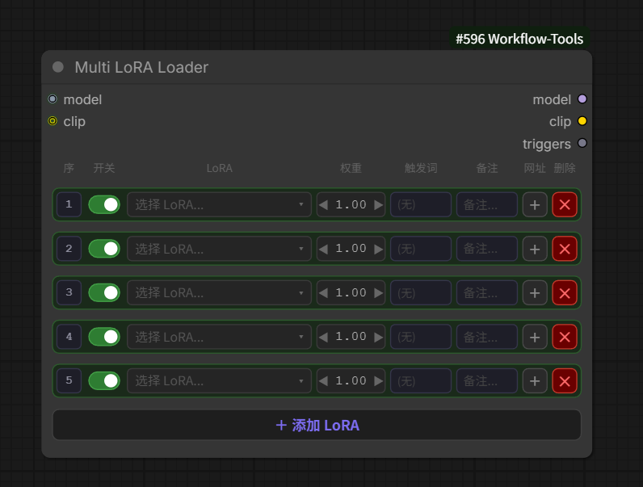
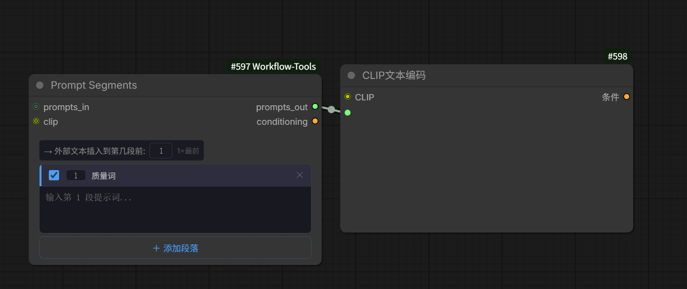
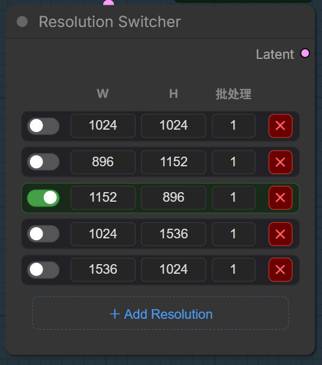

[English](README.md) | [中文](README_ZH.md)

# ComfyUI-Workflow-Tools

ComfyUI 自定义节点集合。

## 安装

将仓库克隆到 ComfyUI 的 custom_nodes 目录：

```bash
cd ComfyUI/custom_nodes
git clone https://github.com/Danchi93/ComfyUI-Workflow-Tools
```

重启 ComfyUI 即可。

### 语言切换

界面默认英文。如需中文，将 `js/` 目录下各 `.js` 文件顶部的 `const LANG = "en"` 改为 `"zh"`。

---

## Multi LoRA Loader

在单个节点中管理多个 LoRA。



### 功能特性

- 每个 LoRA 可单独开关
- 可拖动/点击调整权重
- 每个 LoRA 可自定义触发词，带本地记忆功能
- **触发词输出** — 将已启用 LoRA 的触发词拼接为 STRING 输出，可直接接入提示词
- **可选 CLIP 输入输出** — 接入 CLIP 后可同时作用于含 text encoder 权重的 LoRA；完全是可选的，不接只作用于模型本身
- **每个 LoRA 配一个网址按钮** — 保存下载页链接（C站、LiblibAI 等），一键跳转查看更新/教程
- **缩略图预览** — LoRA 同目录放一张同名图片（`lora.png` 或 `lora.preview.png`），下拉菜单即显示小缩略图，悬停放大查看
- **行排序** — 点击行首的序号，输入目标位置即可移动该行，把常用的 LoRA 排到前面
- 支持备注和动态增删

### 使用方法

添加 **Multi LoRA Loader** 节点，连接模型输入，模型输出用法与标准 LoRA Loader 相同。将 `triggers` 输出接入提示词节点（如 Prompt Segments）即可自动注入触发词。

**行排序**

点击每行开头的序号框，输入目标位置（例如输入 `1` 移到最前）。该行会移动到对应位置，其余行自动顺延。`triggers` 输出的顺序也会跟着变。

**网址按钮**

- 灰色 `＋` — 未配置。点击粘贴下载页链接（自动保存，按 LoRA 记住）。
- 绿色 `↗` — 已配置。点击打开链接。按住 **Shift + 点击** 可编辑网址。
- 触发词和网址都保存在浏览器 localStorage 里，只需配置一次，再次选择该 LoRA 时自动带出。

**缩略图**

在 LoRA 同目录放一张同名图片：

```
models/loras/
  style.safetensors
  style.png            ← 名字旁显示小缩略图
  style.preview.png    ← 也支持
```

鼠标悬停行时，下拉框旁会显示大图预览。

---

## Prompt Segments

将多段提示词合并到一个节点中，按顺序输出，支持标签自动补全、直接 CLIP 调节输出，无需手动拼接或额外编码节点。



### 功能特性

- 动态增删提示词段落
- 每段可单独开关
- 支持为每段添加标签便于管理
- **标签自动补全** — 输入 2 个以上字符自动弹出匹配提示，点击标签即插入；支持键盘 ↑↓←→ 导航 + Tab 补全
- **插入位置控制** — 可指定 `prompts_in` 的接入位置（第 1 段前、第 2 段前等）
- **直接 CLIP 输出** — 可选 CLIP 输入输出，绕过独立文本编码器，直连 KSampler
- 按顺序合并所有启用的段落后输出

### 使用方法

添加 **Prompt Segments** 节点，将 `prompts_out` 连接到 CLIP 文本编码器（或任意文本输入），或连接 CLIP 模型后直接用 `conditioning` 输出接入 KSampler。

---

## Resolution Switcher

快速在预设的分辨率之间切换，直接输出对应尺寸的空 Latent。



### 功能特性

- 提前预设多组常用分辨率组合（宽 W、高 H、批处理数量）
- 通过开关一键快速切换
- 支持动态添加或删除预设
- 告别反复手动输入分辨率

### 使用方法

添加 **Resolution Switcher** 节点，设置常用分辨率，开启需要的那一行，将 **Latent** 输出接入 KSampler 或其他潜空间节点。
